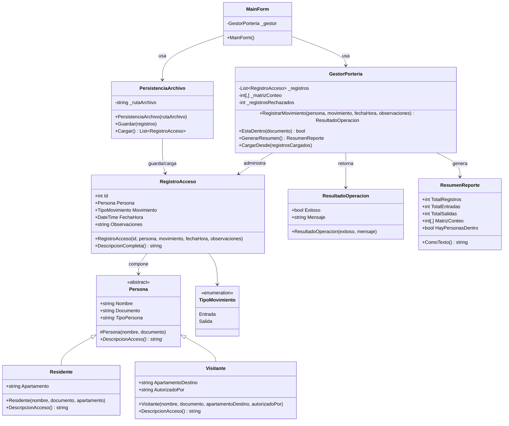

# Registro de Portería

Aplicación de escritorio en C# / Windows Forms para controlar los **ingresos
y salidas** de un conjunto residencial desde la portería.

## 1. Problema que resuelve

El portero necesita llevar un control de quién entra y quién sale del
edificio, diferenciando dos tipos de personas:

- **Residente**: vive en el edificio y tiene un apartamento asignado.
- **Visitante**: viene de afuera, va dirigido a un apartamento y debe estar
  autorizado por alguien (normalmente el residente al que visita).

Por cada movimiento se registra: quién es, si es entrada o salida, la fecha
y hora, y observaciones. La aplicación valida los datos, evita
inconsistencias (por ejemplo, registrar una salida sin una entrada previa),
lleva estadísticas de lo ocurrido y guarda todo en un archivo de texto para
que la información no se pierda al cerrar el programa.

## 2. Funcionalidades principales

- **Registro de acceso**: formulario para registrar entradas/salidas de
  residentes y visitantes, con una tabla que muestra todos los movimientos.
- **Reportes**: genera un informe con totales (entradas, salidas,
  residentes, visitantes, registros rechazados, personas que siguen dentro)
  y una matriz de movimientos por día de la semana y tipo de persona.
- **Persistencia**: guarda y carga los registros desde un archivo de texto
  (`registros_porteria.txt` por defecto). Además de los botones manuales,
  la app carga automáticamente al iniciar y guarda automáticamente al
  cerrarse, para que los datos nunca se pierdan.

## 3. Cómo se cumple cada requisito

| # | Requisito | Dónde está |
|---|-----------|------------|
| 1 | GUI por código, 3 pestañas, tabla, eventos | `UI/MainForm.cs` — `TabControl` con 3 `TabPage` construidas 100% por código (sin diseñador), `DataGridView`, eventos `Click`/`SelectedIndexChanged`/`FormClosing` |
| 2 | Validación con mensajes, if/switch | `ErrorProvider` + `MessageBox` en `MainForm`; decisiones con `if`/`switch` tanto en la UI (`ValidarCamposFormulario`) como en `GestorPorteria.ValidarPersona` |
| 3 | 3+ clases con constructor, herencia + polimorfismo, UML | `Persona` (abstracta) → `Residente` / `Visitante`, cada una sobrescribe `DescripcionAcceso()`. Diagrama en la sección 5 |
| 4 | Lógica separada de la UI | Todo en `Modelo/`, `Logica/` y `Persistencia/` — ninguna de esas clases hace `using System.Windows.Forms` |
| 5 | Vector/lista y matriz | `List<RegistroAcceso>` en `GestorPorteria`; matriz `int[7,2]` de conteos por día de la semana x tipo de persona |
| 6 | Informe con contadores, acumuladores, banderas | `GestorPorteria.GenerarResumen()`: contadores (`contadorEntradas`, `contadorResidentes`, ...), acumulador (`acumuladorTotal`), bandera (`hayPersonasDentro`) |
| 7 | Persistencia en archivo de texto | `Persistencia/PersistenciaArchivo.cs`, formato delimitado por `\|` |
| 8 | Repositorio GitHub con commits de ambos integrantes | Ver sección 6 |

## 4. Estructura del proyecto

```
RegistroPorteria/
├── RegistroPorteria.sln
├── README.md
└── PorteriaApp/
    ├── PorteriaApp.csproj
    ├── Program.cs                     # Punto de entrada (Main)
    ├── Modelo/                        # Clases del problema (sin Forms)
    │   ├── Persona.cs                 # Clase abstracta base
    │   ├── Residente.cs               # Hereda de Persona
    │   ├── Visitante.cs               # Hereda de Persona
    │   ├── RegistroAcceso.cs          # Un movimiento (entrada/salida)
    │   └── TipoMovimiento.cs          # enum Entrada/Salida
    ├── Logica/                        # Lógica de negocio (sin Forms)
    │   ├── GestorPorteria.cs          # Lista, matriz, validaciones, informe
    │   ├── ResultadoOperacion.cs      # Resultado de una operación
    │   └── ResumenReporte.cs          # Datos del informe final
    ├── Persistencia/
    │   └── PersistenciaArchivo.cs     # Guardar/cargar en archivo de texto
    └── UI/
        └── MainForm.cs                # Única clase que usa Windows Forms
```

## 5. Diagrama UML de clases



> GitHub renderiza este diagrama automáticamente al ver el README en el
> repositorio (no hace falta abrir nada más).

## 6. Cómo ejecutarlo

Windows Forms solo se **ejecuta** en Windows. Se puede **compilar** en
cualquier sistema operativo con el SDK de .NET 8, pero para correr la
aplicación y ver la ventana se necesita Windows.

### Opción A: Visual Studio (recomendada)

1. Instalar **Visual Studio 2022** con la carga de trabajo
   *"Desarrollo de escritorio de .NET"*.
2. Clonar el repositorio y abrir `RegistroPorteria.sln`.
3. Presionar `F5` (o el botón ▶ "PorteriaApp") para compilar y ejecutar.

### Opción B: línea de comandos (Windows, con el SDK de .NET 8 instalado)

```bash
git clone <URL-del-repositorio>
cd RegistroPorteria/PorteriaApp
dotnet run
```

Al cerrar la aplicación, los registros quedan guardados automáticamente en
`PorteriaApp/registros_porteria.txt` (se crea la primera vez que se guarda
o se cierra el programa).

## 7. Autores

- Integrante 1: _(completar)_
- Integrante 2: _(completar)_
